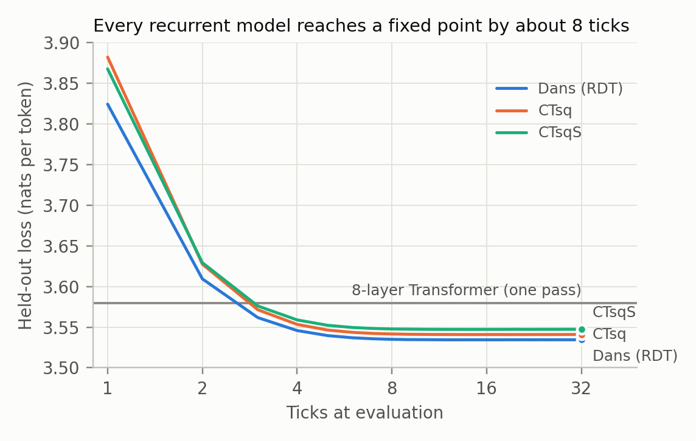

# Thinking Inside the Transformer: A Controlled Study of Continuous Thought Machine Mechanisms in Language Models

*Draft, 2026-11-20. Figures: `scripts/paper_figures.py` (`research/figures/`). Every number is from a committed result. The source for each section is in `research/CTM_TRANSFORMER_DESIGN.md`, and the scripts named there hold the rules each test was judged by, fixed before its runs.*

---

## Abstract

The Continuous Thought Machine (CTM) and the Continuous Memory Machine (CMM) propose that neural computation should unfold over internal ticks, decoupled from the input. The mechanisms they propose are:
- per-neuron models of each neuron's own activation history;
- representations built from the synchronization of neuron pairs over those ticks;
- attention driven by that synchronization.

Earlier attempts to use the CTM for language modelling attach it to a Transformer as a separate head. We instead build a **CTM Transformer**, in which the Transformer's own components take on the CTM and CMM mechanisms:
- each mechanism is zero-initialized;
- the untrained model equals a recurrent-depth Transformer (RDT) at any tick count;
- at one tick, it equals the plain Transformer.

We compare the CTM Transformer's best variant with the RDT's best recipe (Dans), with the plain Transformer as the baseline. Every comparison uses matched size, tuned learning rates, replicate seeds and rules fixed before the runs.

At 50M parameters and 400M tokens:
- **Language modelling:** every CTM Transformer variant beats the 8-layer Transformer by 0.040–0.056 nats and ties Dans (within 0.02).
- **The mechanisms are live:** removing synchronization from the attention queries costs 0.06–0.07 nats.
- **Thinking longer stops paying early:** all recurrent models reach a fixed point by about 8 ticks, and no training change we tried moves it.
- **Adaptive compute and calibration:** no advantage over Dans.
- **The CTM training loss:** destabilizes the recurrence.

Two positive results come from controlled tasks:
1. **A serial parity solution.** On parity, a synchronization-query model found a serial algorithm whose required ticks grow linearly with input length, about 0.5 ticks per bit. It extrapolated to three times the trained length, and ablating the synchronization queries removes it. The same behaviour becomes common in Dans when training ticks scale with the input, so the capability belongs to recurrence trained with enough ticks.
2. **Learning key-value binding.** At width 128, synchronization-driven queries with an attention sink (CTsqS) learn key-value binding in 19 of 25 runs, against 4 of 25 for Dans. Both are at their tuned learning rates, and the result is confirmed on two sets of fresh seeds.
   - The advantage narrows at width 256 (9 of 10 against 6 of 10, not significant).
   - It is absent in pretrained language models.
   - The plain Transformer is at least as reliable throughout.

We conclude that, at this scale, the CTM's mechanisms can be merged into a Transformer without loss, and are used. However, their benefits over a well-tuned recurrent-depth Transformer are confined to small models learning memory tasks from scratch.

---

## 1. Introduction

Recurrent-depth Transformers (RDTs) apply a block of layers repeatedly, so that compute at test time can grow without new parameters (Geiping et al., 2025). The Continuous Thought Machine (CTM; Darlow et al., 2025) goes further. It proposes that:
- internal time should be decoupled from the data;
- each neuron should have its own temporal dynamics (neuron-level models);
- the representation should be the synchronization of neurons over internal time, rather than their instantaneous activation.

The Continuous Memory Machine (CMM; Regan et al., 2026) extends these ideas to memory tasks: associative recall, copying, sorting and parity.

**The problem with a separate head.** Our earlier CTM language model, like other early attempts, was a Transformer backbone feeding a per-position CTM head. Diagnostics showed that the head's ticks contributed nothing:
- every gain came from products of a token-conditioned start state;
- the tick states were about 30 times smaller than that start state;
- the synchronization decays were stuck at zero.

The lesson is that a CTM bolted onto a Transformer can be bypassed.

**Our approach.** We therefore **merge** the CTM into the Transformer. The thinking layers of an RDT become CTM-style:
- their feed-forward neurons carry neuron-level models of their own history;
- their state's neuron pairs accumulate synchronization over ticks;
- that synchronization drives the attention queries and feeds the output.

Every addition is zero-initialized, so any difference from the RDT reference (Dans) is attributable to the CTM mechanisms.

**Contributions:**
1. **The CTM Transformer.** A merge of CTM and CMM mechanisms into a Transformer's own components that is exact at initialization: it equals Dans at any tick count and the Transformer at one tick. It is implemented at parity of training speed (1.12x Dans per update, compiled).
2. **A pre-registered comparison** against the RDT's best and the plain Transformer at 50M parameters and 400M tokens, with:
   - learning-rate checks;
   - per-mechanism ablations;
   - liveness checks;
   - tests of the CTM's adaptive-compute, calibration and training-loss claims.
3. **A study of when thinking longer pays.** Tick-scaling length extrapolation appears as a serial algorithm. It becomes reliable when training ticks scale with input difficulty, and this is a property of recurrence, not of the CTM mechanisms.
4. **A confirmed small-scale benefit of synchronization as memory.** Synchronization-driven attention with a sink helps a capacity-limited recurrent model learn key-value binding. We map where the benefit ends: at larger width, in pretrained language models, on two-hop recall, and in lifelong learning.

Most of our tests find no advantage for the CTM mechanisms over a tuned RDT. We report all of them. A mechanism that ties at matched cost and is demonstrably used is itself informative: it means the CTM's machinery can be adopted inside a Transformer, but at this scale it substitutes for capacity the RDT gets elsewhere, rather than adding to it.

---

## 2. Background

**Continuous Thought Machine (Darlow et al., 2025).** The CTM's main elements are:
- an internal recurrence over ticks;
- neuron-level models (NLMs): private per-neuron MLPs over each neuron's recent pre-activation history;
- synchronization representations, the decayed inner products of neuron pairs' activations over ticks, which are read out for actions (attention queries) and outputs;
- a loss that combines the minimum-loss tick and the most-certain tick;
- certainty as a label-free signal for adaptive compute.

**Continuous Memory Machine (Regan et al., 2026).** The CMM reports gains on algorithmic memory tasks (copy, associative recall, priority sort, parity), on in-context regression, on mazes and on ImageNet-100. Its mechanisms include:
- a synchronization normalization (α/β) whose scale does not depend on the tick count;
- an attention sink, a learned key with a zero value, so that a tick can attend to nothing.

**Recurrent-depth Transformers.** Huginn (Geiping et al., 2025) loops a core block with a prelude and coda, injects the prelude output each iteration, and trains with a randomized number of iterations.

**Our RDT reference, Dans.** Dans is the best of a recipe study at our scale (`research/RDT_RECIPE.md`):
- prelude, core and coda of 2, 4 and 2 pre-norm layers at width 704;
- a zero initial state;
- additive injection;
- an RMSNorm on the recurrent state;
- a randomized depth (log-normal Poisson, mean 15, at most 48) during training.

At 400M tokens Dans beats its 8-layer twin by 0.054 nats (two seeds). At equal compute, a 20-layer Transformer is about 0.02 nats ahead of Dans at 4 iterations (3.562 against 3.585).

---

## 3. The CTM Transformer

Layers 1–2 and 7–8 run once. Layers 3–6 form the thinking group and run for T ticks. The residual stream at the group's output is the state, normalized and added to the input every tick, as in Dans. The CTM and CMM mechanisms live in the Transformer's own components:

| CTM / CMM idea | Where it lives in the Transformer |
|---|---|
| Internal ticks, decoupled from tokens | The thinking group runs T ticks, with T drawn per step as for Dans. |
| Neuron-level models | Each of the 1,856 SwiGLU (Shazeer, 2020) hidden neurons in each thinking layer keeps its gate pre-activation over the last 4 ticks. A private MLP (hidden width 4) maps that history to an activation, which is added to the SwiGLU output through a per-neuron scale initialized to zero (CTnlm). A variant makes it the gate's activation (CTnlmA). |
| Synchronization, normalized as in the CMM (α/β) | The state's normalized neurons are paired at random, 704 pairs for action and 704 for output. Each pair keeps a decayed running average of products over ticks, with a softplus-parametrized learned decay. |
| Synchronization drives attention | Each thinking layer's query is the Transformer's query plus a zero-initialized projection of the action synchronization (CTsq). |
| Synchronization is the output | The output synchronization is added to the state before the coda through a zero-initialized projection (CTso). |
| CMM attention sink | A learned per-head key with a zero value, mixed in by a zero-initialized gate (CTsqS = CTsq + sink). |

**Exactness at initialization.** Unit tests check that:
- the untrained model equals Dans at any depth, and the 8-layer Transformer at depth 1;
- every mechanism receives gradient;
- checkpointed and plain execution agree.

**Size and cost.** The full model (CTfull: NLMs, synchronization in the queries and at the output) has 50.4M non-embedding parameters, against 47.2M for Dans and the 8-layer Transformer. Compiled and at full micro-batch, CTsq trains at 1.12x Dans's time per update with the same loss. NLM variants cost about 2.1x, because per-neuron MLPs are memory-bound.

---

## 4. Protocol

**Language modelling.**
- **Data and schedule:** FineWeb-Edu (Penedo et al., 2024) with a 32k-token BPE vocabulary; sequences of 1,024 tokens; 262,144 tokens per update; 1,526 updates (400M tokens); warmup 100, then cosine decay to 10%.
- **Optimizer:** AdamW (Loshchilov and Hutter, 2019; β = 0.9, 0.95; weight decay 0.1); gradient clip 1; bf16.
- **Evaluation:** held-out loss on 1,024 windows at 16 ticks.
- **Seeds:** two (1234 and 2). The seed changes initialization, data order and the depth sequence.

**Controlled tasks.** These use the same architectures at width 128 (1.6M parameters; 4 heads, SwiGLU 336), trained from scratch with fresh examples each step. Recurrent models train with the language model's tick sampler and are evaluated at 16 ticks unless stated.

**Pre-registration.** Every test's decision rule, thresholds and seeds were written into its script's docstring and committed before its runs. Wins were confirmed on fresh seeds before being reported as results. Where a rule was later found to be flawed, we say so (Appendix A) and do not reinterpret the outcome.

**Matched standard.** Every final comparison uses:
- matched size;
- a learning rate tuned for each family;
- the one-tick twin;
- replicate seeds.

---

## 5. Results

### 5.1 Language modelling at 400M tokens

| Model | Seed 1234 | Seed 2 | Mean | vs Dans | Time per tick vs Dans (uncompiled unless noted) |
|---|---:|---:|---:|---:|---:|
| 8-layer Transformer (baseline) | 3.618 | 3.638 | 3.628 | +0.054 | (one pass) |
| 20-layer Transformer (compute of Dans at 4 ticks) | 3.562 | – | – | – | – |
| **Dans (RDT's best)** | 3.569 | 3.579 | **3.574** | – | 1× |
| CTfull (all three mechanisms) | 3.586 | 3.590 | 3.588 | +0.014 | about 2.9× |
| CTsq (synchronization queries) | 3.584 | 3.579 | 3.582 | +0.008 | 1.12× compiled |
| CTso (synchronization output) | 3.571 | 3.580 | 3.576 | +0.002 | about 1.45× |
| CTnlm (neuron-level models) | 3.570 | 3.574 | 3.572 | −0.002 | about 2.1× compiled |
| CTsqS (CTsq + CMM sink) | 3.579 | 3.593 | 3.586 | +0.012 | – |
| CTsqH (CTsq + homeostasis) | 3.584 | 3.584 | 3.584 | +0.010 | as CTsq |

**Results.**
- **Every CTM Transformer variant beats the baseline Transformer**, by 0.040–0.056 nats.
- **Every variant ties Dans:** by the rule fixed before the runs, none is 0.02 below it.
- **Combining mechanisms is no better than any one alone.**

**Learning rate.** For both CTsq and Dans, 2e-3 is the best of {1e-3, 2e-3, 4e-3}, by 0.08–0.13 nats. The comparison is therefore at each family's best tried rate.

**The mechanisms are used.** At the final checkpoint, removing a mechanism at evaluation costs:
- synchronization queries: 0.063 and 0.070 nats;
- output synchronization: 0.011;
- neuron-level models: 0.005–0.010.

The neuron-level models were unused at step 500 and came into use late. The model relies on the mechanisms without being better than Dans, so the CTM machinery substitutes for capacity Dans finds elsewhere.

**Capability breakdown.** The tie is uniform across token types. Held-out loss broken down by repeated (copyable) and novel tokens, retention distance up to 1,023 tokens, and position shows no category-specific advantage for any variant.

### 5.2 The CTM's own training mechanisms

**The CTM loss** (per token, the mean of the cross-entropy at the minimum-loss tick and at the most-certain tick) **collapses the recurrence.** It fails in every form we tried:
- alone at lr 2e-3 or 1e-3;
- with a final-tick term;
- with a normalized coda input.

In each case the recurrent state's RMS grows steadily (to 40–2,000, against 4–7 in healthy runs), gradient norms reach 10^2–10^11, and predictions fall to near the unigram distribution. The gradient through ticks 2 and later is 30–200 times larger than in a healthy model.

Stopping the CTM loss's gradient at each tick's state (CTsqLD) ends the instability, which identifies the per-tick gradient into the recurrence as the cause. It costs 0.26 nats (3.840 against 3.582), and it does not make certainty a usable stopping signal.

**The CMM attention sink** opens (gates 0.4–0.8) but receives little attention weight. Removing it costs 0.004–0.006 nats.

**Making the neuron-level models the gate activation** (CTnlmA, as in the CTM) ties Dans at 100M tokens (+0.003) at 2.2x the time.

**Homeostasis and structural plasticity** (Leon, 2026), applied to the thinking layers' gate neurons, sparsify feed-forward activity by about a quarter with no change in loss.

### 5.3 Does thinking longer pay?

**Every recurrent language model reaches a fixed point by about 8 ticks.** Dans scores 3.796 at 1 tick, 3.531 at 4, 3.520 at 8 and 3.519 at 16. From 8 to 96 ticks the loss changes by less than 0.001, for Dans and every CTM variant. Three training changes, each aimed at a different cause, leave the fixed point in place:
- per-tick modulation of the injected input (FiLM);
- multi-token prediction;
- deeper training ticks (mean 32).

*Figure 1. Held-out loss against the number of ticks at evaluation, for the 400M-token models (128 held-out windows; two-seed means; the 8-layer Transformer is one seed). Synchronization changes neither the shape of the curve nor where it flattens.*

**Adaptive compute and calibration.**
- **Convergence exit** stops a token once its prediction changes little between ticks. It reaches the 16-tick loss at a mean of about 3.8 ticks, equally for Dans and every CTM variant.
- **The CTM's certainty threshold** needs about 27 ticks to reach the same loss. On language modelling, certainty is not a usable stopping signal, for the CTM Transformer or for Dans.
- **Calibration:** every model is well calibrated (expected calibration error, Guo et al., 2017: 0.004–0.007 at 16 ticks, including the 8-layer Transformer), and no variant is better than Dans.

**Per-token tick budgets in the language model.** We gave harder tokens more ticks, measuring difficulty label-free as the entropy of a 2-tick prediction. Doubling or quadrupling every token's budget changes the loss by less than 0.001 in both models. A first design leaked labels through the budget, and CTsq learned to exploit the leak; see Appendix A.

### 5.4 Algorithmic tasks and serial computation

**The CMM's tasks from scratch** (width 128, 5,000 updates, 3 seeds; copy, associative recall, priority sort, parity).
- Dans extrapolates copy and sort to longer inputs better than both Transformers: copy OOD 10.4% against 4.5% for T8. T20 is no better than T8, so the gain comes from the recurrence.
- No CTM variant beats Dans on any out-of-distribution split.
- No model learns associative recall in this budget. All sit at about 32% of queries right, the level reached by choosing among the values present.

**A serial parity solution.** Of 72 recurrent runs in that grid, exactly one gained accuracy with more ticks, a CTsqS run. We reproduced it and analysed it:
- **It is a serial algorithm.** The first tick reaching 90% accuracy grows linearly with input length (Figure 2): 2, 6, 12, …, 55 ticks for 10, 20, …, 100 bits, about 0.5 ticks per bit (least squares through the origin, 0.50).
- **It reaches far:** 90% on inputs up to three times the trained length (81–120 bits) at 64 ticks.
- **It depends on the synchronization queries:** ablating them drops it to chance, while ablating the sink changes nothing.

Under the usual tick sampler, however, the solution is found in only 1 of 40 runs with synchronization queries and 0 of 30 without.
- More training ticks do not make it more common.
- A length curriculum makes training fit reliably, but produces fixed-reach solutions instead. Dans finds those as often.
- Three further training changes do not produce it either (0 of 10 runs each, for CTsq and for Dans): the progressive loss of Bansal et al. (2022), a monotone loss across ticks, and width 256.

*Figure 2. The extrapolating CTsqS parity run (seed 1). The first tick at which accuracy on inputs of a given length reaches 90% grows linearly with the length, inside and beyond the trained range (shaded). The line is a least-squares fit through the origin.*

**Length-scaled ticks make tick-scaling extrapolation reliable, without the CTM.** When training ticks grow with the input (ceil(0.75 L) + U{0..8}), extrapolating seeds number:

| Setting | CTsq | Dans |
|---|---:|---:|
| Parity, length-scaled ticks | 2 / 10 | 4 / 10 |
| With a curriculum | 4 / 10 | 2 / 10 |
| Parity inside text, per-token budgets | 4 / 10 | 2 / 10 |

- Across the three settings, CTsq has 10 of 30 runs and Dans 8 of 30.
- Under length-scaled ticks every seed that fits the trained lengths extrapolates, some to four times the trained length beyond any tick count seen in training. Fitting, not finding, is the bottleneck.
- With length-scaled ticks, the CTM variants extrapolate on 0–4 of 10 seeds:
  - neuron-level models (4);
  - the NLM activation (3);
  - NLM history 32 (3);
  - the other NLM sizes (0–2).
- No variant reaches the pre-registered win margin over Dans (4 of 10).

The CTM's central behaviour, solving harder inputs by thinking longer, is real in these models. It is a property of recurrence trained with enough ticks.

**Reasoning tasks inside text at 50M parameters.** We continued pretraining for 100M tokens with problems written into FineWeb-Edu text: reversed addition, variable tracking, parity and nested expressions.
- Only addition is learned, in-distribution, at 58–99%.
- Ticks pay on no task, including with input-scaled budgets.
- Neither a 50% problem share nor a size curriculum makes the other tasks learnable.
- CTsq learned addition in 9 of 10 continued-training runs and Dans in 6 of 10. On the 8 fresh replicates each (7 against 5), p = 0.29. The failures trace to one Dans starting checkpoint.

### 5.5 Synchronization as memory

The CTM paper names synchronization as a memory mechanism. In the CMM grid no model learned recall, so we first found a training recipe under which the Transformer learns it.

**Learnability screen.** In the recall task, the context holds N key-value pairs (64 keys, 16 values) and then 4 queries. Models train on N 2–16 and are tested on N 17–32 out of distribution. Two recipes leave T8 at 31–40% after 40,000 updates: the original task trained longer, and querying every key. A curriculum over the number of pairs, from N 2 up to the full range by update 9,800, makes T8 reach 90% within 3,000–4,000 updates.

**Runs are all-or-nothing.** Each run either binds keys to values, reaching about 100% in distribution and 73–92% on N 17–32, or stays at about 31%. The primary measure is therefore the number of runs that bind.

| Phase (rules fixed before each) | Seeds | T8 | Dans | CTsq | CTsqS | CTfull | CTnlmA |
|---|---|---:|---:|---:|---:|---:|---:|
| Comparison | 0–4 | 4/5 | 2/5 | 3/5 | 4/5 | 3/5 | 2/5 |
| Confirmation | 5–14 | 10/10 | 1/10 | 6/10 | 7/10 | 5/10 | – |
| Replication | 15–24 | 9/10 | 1/10 | – | 8/10 | – | – |
| **Total at lr 1e-3** | 0–24 | **23/25** | **4/25** | – | **19/25** | – | – |

**Results.**
- **Synchronization helps a small recurrent model learn binding.**
  - On fresh seeds the three synchronization-query cells bound in 18 of 30 runs, against Dans's 1 of 10 (one-sided Fisher p = 0.007). This hypothesis was declared after the first phase and tested only on the fresh seeds.
  - CTsqS replicated on a further 10 fresh seeds: 8 of 10 against 1 of 10 (p = 0.003). Its OOD accuracy was 68.4 against 24.5, higher on 9 of 10 seeds.
  - Over all 25 seeds, CTsqS bound in 19 and Dans in 4 (p = 2 × 10^−5).
- **It is not a learning-rate artifact.**
  - Over 3e-4, 1e-3 and 2e-3, Dans's best rate is 1e-3, where it binds most often; at the other rates it binds less (1 of 5).
  - Plain synchronization queries without the sink (CTsq) are sensitive to the learning rate. At the rate the protocol selected (2e-3, picked by a tie-break on 5 seeds), CTsq bound in only 2 of 10 fresh runs, against 6 of 10 at 1e-3. So the broader claim "synchronization queries help" did not survive tuning by our rule (pooled p = 0.062). The CTsqS result did.
- **What is gained is learning, not capacity.** Runs that bind generalize to longer inputs about equally, whatever the model: mean OOD of bound runs is 79–88% per cell and phase. The exception is a single bound Dans run in the confirmation, at 35%.
- **More ticks do nothing:** 64 ticks minus 16 is within ±0.04 points.
- **The plain Transformer is at least as reliable** (23 of 25).

*Figure 3. Share of runs that learn key-value binding (query accuracy at least 90% on N 2–16), at lr 1e-3, the tuned rate of every model. Width 128: seeds 0–24, from three pre-registered phases. Width 256: seeds 0–14, tuning and test phases.*

**Where the benefit ends.**
- **Width 256** (6.3–6.5M parameters; learning rates tuned, test on fresh seeds): CTsqS binds 9 of 10 and Dans 6 of 10 (p = 0.15), so the rule does not hold. The gap narrows with width: Dans binds 4 of 25 at width 128, against 11 of 15 at width 256.
- **Pretrained language models (d704):** we continued pretraining from the 400M-token checkpoints for 100M tokens, with recall problems in text under the same curriculum.
  - Both Dans and CTsqS reach 100% in distribution and 97–100% on N 17–32.
  - Snapshots every 25 updates show recall emerging after 50–75 updates (13–20M tokens) in both models, with no difference.
  - Pretraining supplies what synchronization supplied at width 128.
- Figure 4 shows how recall emerges in both pretrained models.
- **Two-hop recall** (A→B, B→value): T8, Dans and CTsqS all stay at about 33% through 40,000 (T8) and 20,000 (recurrent) updates. Ticks do not help.

*Figure 4. Recall accuracy on N 2–16 during continued pretraining of the 400M-token d704 models, scored every 25 updates (6.6M tokens). Both models cross 80% after 50–75 updates; every run stays at 99–100% from update 125 to the end (381).*

### 5.6 Lifelong learning

**Setup.** At width 128, four tasks share one input format and conflict in their outputs: copy, reverse, sort and increment. Each is trained in turn for 1,000 updates, two cycles, with no replay.
- **Without replay, every model forgets completely.** Each task falls from 97–100% to 0–1% after the next phase, and relearning is at the floor.
- **With 1% replay** (the rate chosen by a pilot to make forgetting partial), forgetting is:

| Model | T8 | Dans | CTsqS | CTnlmA |
|---|---:|---:|---:|---:|
| Forgetting (points) | 39.5 | 45.3 | 49.7 | 50.3 |

**Rule outcomes.**
- Neither CTM cell differs from Dans by the rule.
- T8 forgets less than both CTM cells.

The CTM mechanisms do not help lifelong learning here.

---

## 6. Discussion

**What transfers.** The CTM's mechanisms can be merged into a Transformer exactly and cheaply. Synchronization-driven queries train at 1.12x the RDT's cost, and the model relies on them. But at 50M parameters and 400M tokens they tie a tuned RDT on language modelling, and they leave unchanged the properties the CTM is known for:
- adaptive compute;
- calibration;
- tick-scaling generalization.

**Why the ticks stop paying.** Every recurrent model we trained reaches a fixed point by about 8 ticks on web text. Neither per-token budgets nor tick-dependent modulation nor deeper training moves it.

On controlled serial tasks, thinking longer pays when, and largely only when, training ticks scale with the problem. In that regime the RDT benefits as much as the CTM Transformer. The CTM's central claim is a property of recurrence trained with input-scaled compute, rather than of synchronization or neuron-level models.

**Where synchronization helps.** Our one robust advantage is in learning: a small recurrent model with synchronization-driven queries and a sink finds key-value binding far more often than the RDT. The advantage is about learning rather than what is learned, because bound runs generalize identically. It shrinks as the model grows and is absent once pretraining has formed in-context recall. This suggests that synchronization can act as an inductive bias for binding when capacity or data is scarce.

**Limitations.**
- **Scale:** our language models are 50M parameters at 400M tokens. The CTM's benefits may need scale we did not reach.
- **Seeds:** language-model comparisons rest on two seeds, so differences under about 0.02 nats are within seed spread.
- **Task scope:**
  - the controlled tasks are small and synthetic;
  - the recall advantage is shown on one binding task, at width 128;
  - lifelong learning was tested only on interfering tasks.
- **Training setup:** we used AdamW throughout, while Leon (2026) reports SGD for the biological mechanisms.
- **Reproducibility:** compiled kernels make runs reproducible only to about 1e-4 in loss.

---

## 7. Conclusion

A Transformer can take on the Continuous Thought Machine's mechanisms in its own layers, exactly and at little extra cost, and it uses them. At the scale we studied it does not beat a well-tuned recurrent-depth Transformer at language modelling. The CTM's signature behaviours are either properties of recurrence trained with enough ticks, or absent:
- solving harder inputs by thinking longer: a property of recurrence trained with enough ticks;
- certainty-based adaptive compute: absent;
- calibration: absent.

Its clearest benefit is an inductive bias for learning key-value binding in small recurrent models, from synchronization-driven attention with a sink. That benefit is confirmed under strict controls, and it fades with width and pretraining.

---

## Appendix A. Pre-registration notes and corrections

- **Mixed-loss comparison (CTsqL pilots).** A pilot rule compared logged losses that included CTM loss terms against a final-tick-only loss. We report the like-for-like final-tick comparison alongside the rule's outcome.
- **Relative efficiency (exit calibration).** A rule measured tick efficiency relative to each model's own 16-tick loss. CTsqLD passed it only because its loss was 0.27 nats worse. We do not report this as an advantage.
- **Label leak (per-token budgets).** Budgets ranked by each token's own cross-entropy leaked the target. CTsq exploited the leak (4.090 with label-ranked budgets, 8.8 without), probably through the synchronization normalization's per-position tick count. The label-free rerun is the reported result.
- **Learning-rate tie-break (recall).** CTsq's selected rate (2e-3) won a 5-seed tie-break on OOD accuracy and proved worse on fresh seeds. We report the rule's outcome as negative.
- **Shared compile cache.** One run crashed twice when concurrent workers corrupted a shared autotune cache. It was rerun with a private cache. Runs lost to crashes or restarts were rerun with the same seeds.

## Appendix B. Every pre-registered test

| Test | Outcome |
|---|---|
| Language modelling, 400M tokens (CTfull, CTsq, CTso, CTnlm, CTsqS, CTsqH) | Tie with Dans; all beat the 8-layer Transformer |
| Learning-rate check (CTsq, Dans) | 2e-3 best for both; tie stands |
| CTM loss (four forms) | Collapse, or stable at +0.26 nats |
| Adaptive compute, calibration | No advantage over Dans |
| Per-token budgets, LM (label-free) | Ticks do not pay |
| Tick contribution (FiLM, MTP, deeper ticks) | All fail; fixed point unchanged |
| CMM tasks from scratch | No CTM win; recurrence beats Transformers on copy and sort OOD |
| Parity tick-scaling (sampler, more ticks, curriculum, four training changes, Leon mechanisms, NLM sizes) | Serial solution once in 40 sync-query runs; reliable with length-scaled ticks for Dans and CTM alike |
| Reasoning in text, d704 (three experiments) | Only addition learned; no CTM win |
| Recall: comparison, confirmation, learning-rate check, replication | **CTsqS binds more reliably than Dans (19/25 vs 4/25)**; plain CTsq not robust to tuning |
| Recall at width 256 | Does not hold (9/10 vs 6/10) |
| Recall in text and its emergence, d704 | Both at ceiling; no difference in speed |
| Two-hop recall | Not learnable by any model |
| Lifelong learning, without and with replay | No CTM win |

## References

- Bansal, A., Schwarzschild, A., Borgnia, E., Emam, Z., Huang, F., Goldblum, M., and Goldstein, T. (2022). End-to-end Algorithm Synthesis with Recurrent Networks: Extrapolation without Overthinking. *NeurIPS 2022*. arXiv:2202.05826.
- Darlow, L., Regan, C., Risi, S., Seely, J., and Jones, L. (2025). Continuous Thought Machines. *NeurIPS 2025* (spotlight). arXiv:2505.05522.
- Geiping, J., McLeish, S., Jain, N., Kirchenbauer, J., Singh, S., Bartoldson, B. R., Kailkhura, B., Bhatele, A., and Goldstein, T. (2025). Scaling up Test-Time Compute with Latent Reasoning: A Recurrent Depth Approach. *NeurIPS 2025*. arXiv:2502.05171.
- Guo, C., Pleiss, G., Sun, Y., and Weinberger, K. Q. (2017). On Calibration of Modern Neural Networks. *ICML 2017*.
- Leon, F. (2026). Biologically Inspired Mechanisms for Facilitating Grokking in Multilayer Perceptrons. arXiv:2608.28184.
- Loshchilov, I., and Hutter, F. (2019). Decoupled Weight Decay Regularization. *ICLR 2019*. arXiv:1711.05101.
- Penedo, G., Kydlíček, H., Ben allal, L., Lozhkov, A., Mitchell, M., Raffel, C., Von Werra, L., and Wolf, T. (2024). The FineWeb Datasets: Decanting the Web for the Finest Text Data at Scale. *NeurIPS 2024 Datasets and Benchmarks Track*. arXiv:2406.17557.
- Regan, C., Arulkumaran, K., Darlow, L., Druga, S., Risi, S., and Jones, L. (2026). Continuous Memory Machines. *NeurIPS 2026 Workshop on Personalized, Aligned, Long-Term Memory for AI Systems (PALM)*. arXiv:2610.07907.
- Shazeer, N. (2020). GLU Variants Improve Transformer. arXiv:2002.05202.
