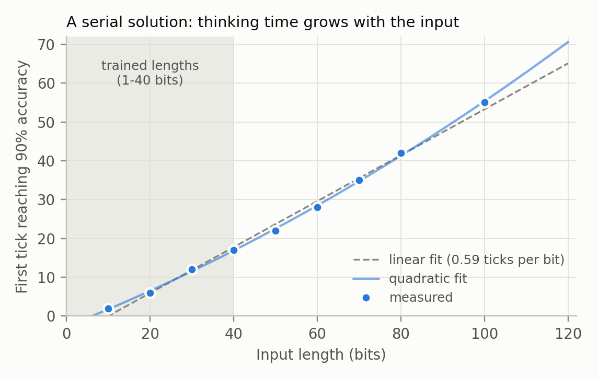
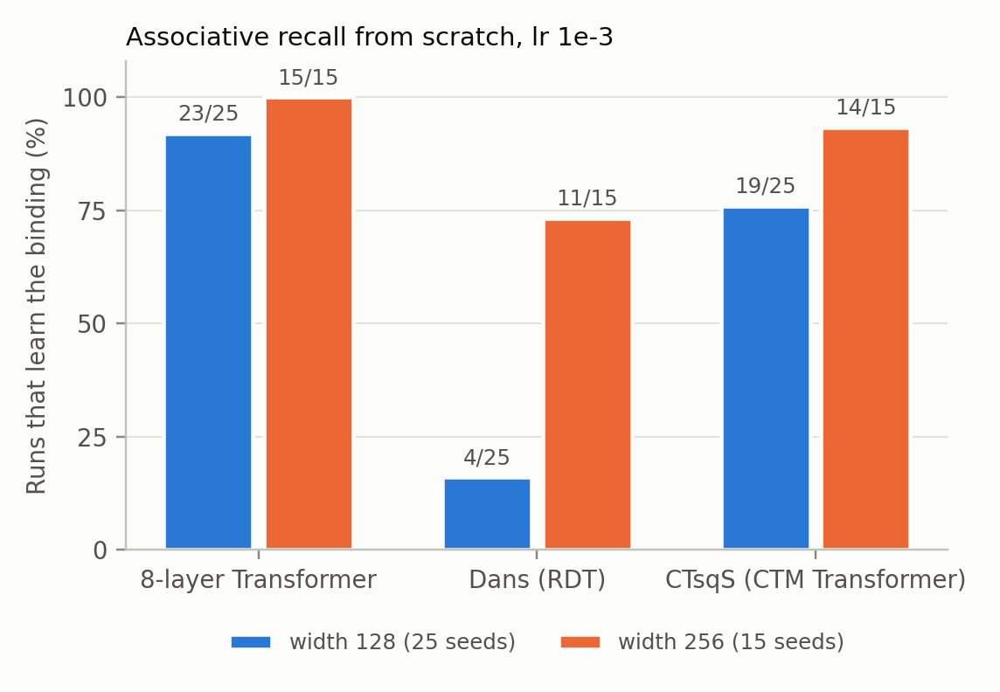
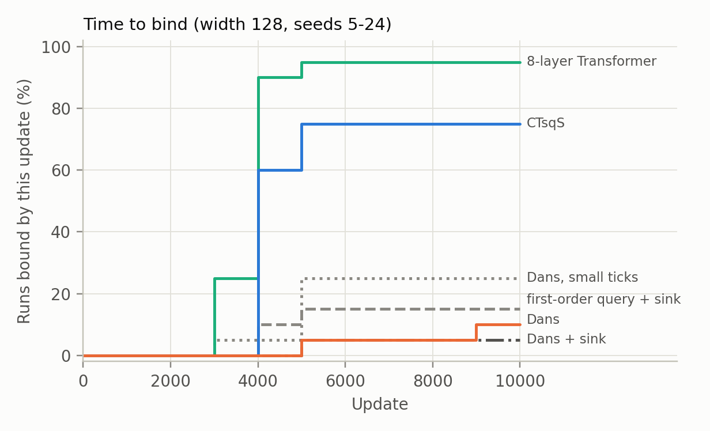
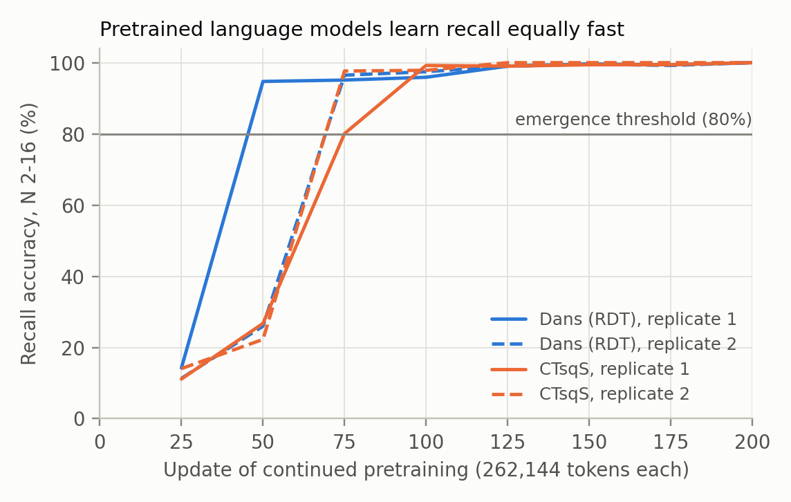

# Thinking Inside the Transformer: A Controlled Study of Continuous Thought Machine Mechanisms in Language Models

*Revision draft, 2026-11-27, after external review (`research/REVIEW_RESPONSE.md`). Figures: `scripts/paper_figures.py` (`research/figures/`). Every number is from a committed result; each test's rules were fixed in its script before its runs (Appendix C). Items marked **[Pending]** await runs in progress.*

---

## Abstract

Do the mechanisms of the Continuous Thought Machine (CTM) and the Continuous Memory Machine (CMM) add anything to a well-tuned recurrent-depth Transformer (RDT)? Those mechanisms are:
- per-neuron models of each neuron's recent activation history;
- representations built from the synchronization of neuron pairs over internal ticks;
- attention driven by that synchronization, and an attention sink.

We merge them into the Transformer's own components, rather than attaching a CTM as a separate module. Each addition is zero-initialized, so the untrained model equals the RDT reference (Dans) at any tick count and the plain Transformer at one tick. Every comparison is held to the same standard: matched size, tuned learning rates on a √2 grid, replicate seeds, and rules fixed before the runs. All claims are about the mechanisms *as merged here*, at 50M parameters and 400M tokens for language modelling, and at 1.6M parameters for controlled tasks.

**Language modelling.** No variant is better than Dans. On five seeds, the two tuned CTM arms are slightly worse: CTsq by 0.006 nats and CTsqS by 0.009 (Holm p = 0.039 and 0.030). Both differences also lie inside a 0.02-nat equivalence margin, so the cost is detectable but small. The mechanisms are used: removing synchronization from the queries costs 0.06–0.07 nats. Dans beats the parameter-matched 8-layer Transformer by 0.056 nats, but only per parameter:
- spending Dans's training compute on 8.4 times the tokens instead, the same 8-layer Transformer is 0.41 nats better than Dans;
- at Dans's 4-tick compute, a 20-layer Transformer is 0.014 nats better than Dans at 4 ticks.

Held-out loss stops improving by about 8 ticks in every recurrent model, although the state keeps changing by about 0.2% per tick.

**The CTM's training claims**, as merged here: certainty is not a usable stopping signal, calibration does not distinguish the models, and the CTM loss destabilizes the recurrence.

**One positive result: synchronization and key-value binding.** At width 128, synchronization-driven queries with an attention sink (CTsqS) learn key-value binding in 15 of 20 confirmatory runs, against 2 of 20 for Dans (p = 3 × 10⁻⁵). Pre-registered controls attribute the gain to second-order synchronization:
- the sink alone binds in 1 of 20;
- the same query pathway carrying a first-order running mean, with identical parameters, binds in 3 of 20;
- Dans with a smaller tick sampler binds in 5 of 20.

Probes show that binding is the formation of a single retrieval head, and that the bound model no longer needs the synchronization query: synchronization helps the model learn the binding, but is not part of the solution.

The plain Transformer binds in 19 of 20. The official CTM, trained from its authors' code on the same task, binds in 0 of 20, and at our budgets learns none of copy, sort or parity either. The advantage over Dans narrows at width 256 and is absent in pretrained language models.

We conclude that, at this scale, a Transformer can host the CTM's mechanisms and uses them, but on language modelling they cost a little against a tuned RDT rather than helping, and the RDT's own advantage over the Transformer holds per parameter, not per unit of compute. Synchronization does carry a specific inductive bias that helps a small recurrent model learn binding.

---

## 1. Introduction

**Background.** Recurrent-depth Transformers (RDTs) apply a block of layers repeatedly, so that compute at test time can grow without new parameters (Dehghani et al., 2019; Geiping et al., 2025). The Continuous Thought Machine (CTM; Darlow et al., 2025) goes further. It proposes that:
- internal time should be decoupled from the data;
- each neuron should have its own temporal dynamics (neuron-level models);
- the representation should be the synchronization of neurons over internal time, rather than their instantaneous activation.

The Continuous Memory Machine (CMM; Regan et al., 2026) extends these ideas with explicit memory, and reports gains on associative recall, copying, sorting and parity.

**The question.** Do these mechanisms add anything once a Transformer already has a well-tuned recurrence? Our own earlier CTM language model attached a CTM head to a Transformer backbone, and diagnostics showed the head's ticks contributed nothing (Appendix A):
- every gain came from products of a token-conditioned start state;
- the tick states were about 30 times smaller than that start state;
- the synchronization decays were stuck at zero.

A head can be bypassed. We therefore **merge** the mechanisms into the thinking layers of an RDT. Each addition is zero-initialized, so any difference from the RDT reference is attributable to the mechanisms.

**Contributions:**
1. **The CTM Transformer:** a merge of CTM and CMM mechanisms into a Transformer's own components that is exact at initialization (§3).
2. **A pre-registered comparison** with a tuned RDT and the plain Transformer on language modelling (§5.1–5.3), with:
   - a √2 learning-rate grid for every arm;
   - five seeds and equivalence tests;
   - Transformers matched in compute as well as parameters;
   - ablations and liveness checks;
   - tests of the CTM's adaptive-compute, calibration and training-loss claims.
3. **A confirmation that tick-scaling extrapolation belongs to recurrence** trained with input-scaled ticks (§5.4). This is a known result for looped and recurrent networks (Schwarzschild et al., 2021; Bansal et al., 2022; Fan et al., 2025). We confirm it here, including for the CTM variants, and add one serial parity solution as a case study.
4. **An attributed effect of synchronization on learning key-value binding** in small recurrent models, with controls for the sink, the extra query pathway and the baseline's tick sampler (§5.5). We also map where it ends, and train the official CTM on the same tasks.

Most of our tests find no advantage for the CTM mechanisms over a tuned RDT, and we report every one (Appendix B).

---

## 2. Background and related work

**Continuous Thought Machine** (Darlow et al., 2025). The CTM's main elements are:
- an internal recurrence over ticks;
- neuron-level models (NLMs): private per-neuron MLPs over each neuron's recent pre-activation history;
- synchronization representations, the decayed inner products of neuron pairs' activations over ticks, read out for actions (attention queries) and outputs;
- a loss combining the minimum-loss tick and the most certain tick;
- certainty as a label-free signal for adaptive compute.

The CTM is evaluated on images, mazes, parity, sorting and reinforcement learning, not on language modelling.

**Continuous Memory Machine** (Regan et al., 2026). The CMM pairs the CTM's short-term history with an explicit long-term memory. We take two of its mechanisms:
- a synchronization normalization (α/β) whose scale does not depend on the tick count;
- an attention sink.

Its associative recall task differs from ours: 2–6 items of three 6-bit vectors, about 200,000 updates and 500K-parameter models. On that task it reports the CTM well behind a Transformer (loss 3.2 × 10⁻² against 2.7 × 10⁻⁴), as also on copying.

**Looped and universal Transformers.** Universal Transformers share one block across depth and halt per position with Adaptive Computation Time (Dehghani et al., 2019; Graves, 2016). PonderNet makes halting probabilistic (Banino et al., 2021). Saunshi et al. (2025) show that looped Transformers can match much deeper models on reasoning, while lagging on perplexity at matched parameters. Huginn (Geiping et al., 2025) scales a recurrent-depth Transformer, with a prelude, a looped core and a coda, trained with a randomized number of iterations. Our RDT recipe follows Huginn's structure, with recipe choices tuned at our scale (§3).

**Length generalization by thinking longer.** Recurrent networks trained on easy instances can solve harder ones by running more iterations (Schwarzschild et al., 2021). A recall-and-progressive-loss recipe prevents "overthinking" (Bansal et al., 2022). Looped Transformers generalize in length when their iteration count scales with the input, including on parity (Fan et al., 2025). Recurrent blocks with suitable position embeddings extrapolate arithmetic (McLeish et al., 2024). Our §5.4 confirms these findings in our setting.

**Synchronization as a second-order state.** The CTM's synchronization is a decayed running sum of products of neuron pairs over ticks. That makes it a second-order, fast-weight-like statistic of the state's trajectory, related to fast-weight programmers and linear attention (Schlag et al., 2021). Here, though, the accumulation runs over internal ticks within one position, not over tokens.

**Attention sinks.** Language models place large attention weight on initial tokens, which act as sinks; StreamingLLM keeps them to stabilize streaming attention (Xiao et al., 2024). Sinks emerge as a way for heads to attend to nothing (Gu et al., 2025). The CMM's learned sink with a zero value makes this explicit.

---

## 3. The CTM Transformer

### 3.1 The reference RDT (Dans)

**The recurrence.** Let x be the token embeddings, P the prelude (2 pre-norm Transformer layers), C the thinking group (4 layers) and D the coda (2 layers), all at width 704 with SwiGLU feed-forward networks (Shazeer, 2020) and RoPE. Dans computes

$$e = P(x), \qquad s_0 = 0, \qquad s_t = C\big(\mathrm{RMSNorm}(s_{t-1}) + e\big)\quad (t = 1, \dots, T), \qquad \hat y = W_{\text{head}}\,\mathrm{RMSNorm}\big(D(s_T)\big).$$

**The tick count.** In training it is drawn per update:

$$T = \min(1 + N, 48), \qquad N \sim \mathrm{Poisson}(e^{\tau}), \qquad \tau \sim \mathcal{N}(\ln 15 - \sigma^2/2,\ \sigma^2), \qquad \sigma = 0.5.$$

This has mean 15.8; evaluation uses T = 16. Backpropagation runs through every tick, with no truncation. A forward pass applies 2 + 4T + 2 layers per token: 68 at 16 ticks, against 8 for the 8-layer Transformer (T8).

**How Dans was chosen.** Dans is the outcome of a recipe study at this scale, run before any CTM experiment. We compared Huginn's sandwich norm, pre-norm, concatenation and additive injection, random and zero initial states, and coda norms. Each variant ran at lr 1e-3, 2e-3 and 4e-3 with its one-tick twin. A recipe was adopted only if its randomized-depth loss beat the best earlier RDT and was at least 0.04 nats below its own one-tick twin, so that the recurrence still pays. The name records the choices: variant D (pre-norm, zero state), **a**dditive injection, **n**o coda norm, and an RMSNorm on the recurrent **s**tate. At one tick, Dans is exactly T8.

### 3.2 The mechanisms

**Synchronization.** Let z_t = RMSNorm(s_t) be the normalized state after tick t. A synchronization module has P = 704 random neuron pairs (l_i, r_i) and a learned decay γ_i = exp(−softplus(ρ_i)), with softplus(ρ_i) initialized to 0.01. It keeps

$$\alpha_{t,i} = \gamma_i\,\alpha_{t-1,i} + z_{t,l_i} z_{t,r_i}, \qquad \beta_{t,i} = \gamma_i\,\beta_{t-1,i} + 1, \qquad S_{t,i} = \alpha_{t,i} / \beta_{t,i},$$

starting from α₁ = z₁,ₗ z₁,ᵣ and β₁ = 1. This is the CMM's normalization; the CTM divides by √β. The softplus keeps the decay's gradient nonzero, where the CTM clamps it at zero. There are separate modules for action (S^act) and output (S^out).

**Synchronization queries (CTsq).** In thinking layer ℓ at tick t ≥ 2, the attention query is

$$q_{t,\ell} = W_q^{\ell}\,\mathrm{RMSNorm}(h) + W_S^{\ell}\, S^{\text{act}}_{t-1}, \qquad W_S^{\ell} = 0 \text{ at initialization.}$$

**Synchronization output (CTso).** The coda reads s_T + W_O S^out_T, with W_O = 0 at initialization.

**The attention sink (CMM).** Each head of each thinking layer has a learned sink key k_sink with a zero value. Let y_sink be the head's attention output with the sink prepended to the keys, and y_attn the output without it. The head's output is

$$y = y_{\text{attn}} + g\,(y_{\text{sink}} - y_{\text{attn}}),$$

with a per-head gate g = 0 at initialization.

**Neuron-level models (CTnlm, CTnlmA).** Each of the 1,856 SwiGLU gate neurons j keeps its pre-activations over the last M = 4 ticks. A private MLP f_j (M → 8 → GLU → 4 → 2 → GLU → 1) maps that history to m_{t,j}. The feed-forward output is

$$W_{\text{down}}\big[(\mathrm{silu}(a_t) + c \odot m_t) \odot W_{\text{up}} u\big] \ \ (\text{CTnlm}), \qquad W_{\text{down}}\big[m_t \odot W_{\text{up}} u\big] \ \ (\text{CTnlmA}),$$

where a_t is the gate pre-activation and the per-neuron scale c is 0 at initialization. CTnlmA follows the CTM and is not zero-initialized.

**The first-order control (CTsq1S, §5.5).** Identical to CTsqS, except that the products are replaced by single neurons:

$$\alpha_{t,i} = \gamma_i\,\alpha_{t-1,i} + z_{t,l_i}.$$

It has the same parameter count.

**Exactness.** Unit tests check that:
- the untrained model equals Dans at any tick count, and T8 at one tick;
- every mechanism receives gradient;
- checkpointed and plain execution agree.

### 3.3 Variants

| Name | Mechanisms | Zero-init (equals Dans untrained) | Where |
|---|---|---|---|
| **Dans** | RDT reference | – | all |
| **T8**, **T20**, **T8x** | 8- and 20-layer Transformers (T20: Dans's compute at 4 ticks; T8x: T8 trained on 8.4× the tokens, Dans's training compute) | – | all |
| CTsq | synchronization queries | yes | §5.1, 5.4, 5.5 |
| **CTsqS** | CTsq + CMM sink (the CTM Transformer's best) | yes | all |
| CTso | synchronization output | yes | §5.1 |
| CTnlm | neuron-level models, added to the activation | yes | §5.1, 5.4 |
| CTnlmA | neuron-level models as the activation | no | §5.2, 5.4, 5.6 |
| CTfull | CTnlm + CTsq + CTso | yes | §5.1, 5.4 |
| CTsqH | CTsq + homeostatic thresholds (Leon, 2026) | yes | §5.1, 5.2 |
| CTsqL, CTsqLD | CTsq trained with the CTM loss; LD on detached readouts | yes (objective differs) | §5.2 |
| DansS, DansT4, CTsq1S | controls: Dans + sink; Dans with a mean-4 tick sampler; first-order query + sink | yes | §5.5 |

**Size and cost.** Non-embedding parameters are 47.2M for Dans and T8, 49.2M for CTsq and CTsqS (the query projections add 2.0M), 50.1M for CTfull and 118.1M for T20. Compiled, CTsq trains at 1.12× Dans's time per update. CTnlm takes 2.1×, because per-neuron MLPs are memory-bound. Other variants ran uncompiled, and their times are not comparable.

---

## 4. Protocol

**Language modelling.**
- **Data:** FineWeb-Edu (Penedo et al., 2024) with a 32k-token BPE vocabulary.
- **Schedule:** sequences of 1,024 tokens; 262,144 tokens per update; 1,526 updates (400M tokens, about 8 tokens per parameter); warmup 100, then cosine decay to 10%.
- **Optimizer:** AdamW (Loshchilov and Hutter, 2019; β = 0.9, 0.95; weight decay 0.1); gradient clip 1; bf16.
- **Learning rate:** every main arm (Dans, CTsq, CTsqS, T8, T20) is tuned on a √2 grid around 2e-3 (§5.1).
- **Seeds:** 1234 and 2–5 (five) for Dans, CTsq, CTsqS, T8 and T20; 1234, 2 and 3 for T8x; 1234 and 2 for the untuned screens. The seed changes initialization, data order and the tick sequence.
- **Evaluation set:** a single set throughout. Every language-model number is held-out loss on the same 1,024 validation windows (1,048,576 tokens), at 16 ticks unless stated (`scripts/lm_unified_eval.py`).

**Controlled tasks.**
- **Models:** the same architectures at width 128 (1.6M parameters; 4 heads of 32; SwiGLU 336), trained from scratch with fresh examples each step from a per-seed generator.
- **Training:** AdamW (β = 0.9, 0.95; weight decay 0.1), warmup 200, cosine to 10%, batch 128, clip 1.
- **Ticks:** recurrent models train with the language model's tick sampler and are evaluated at 16 ticks unless stated.
- **Task formats** are in Table 1.

*Table 1. Controlled-task formats.*

| Task | Sequence → answer | Train | Test ID / OOD | Budget |
|---|---|---|---|---|
| Copy | BOS s₁..s_L SEP → s₁..s_L (16 symbols) | L 1–32 | 1–32 / 33–64 | 5,000 updates |
| Recall (grid) | BOS k₁v₁..k_Nv_N, then 4 × (QUERY k → v) (64 keys, 16 values) | N 2–16 | 2–16 / 17–32 | 5,000 |
| Recall (binding study) | as above, curriculum N 2..min(16, 2 + ⌊step/700⌋) | | 2–16 / 17–32 | 10,000 |
| Sort | BOS p₁v₁..p_Nv_N SEP → values by priority | N 4–16 | 4–16 / 17–50 | 5,000 |
| Parity | BOS b₁..b_n SEP → parity | n 1–40 | 1–40 / 41–80 (to 120 in §5.4) | 5,000 (10,000 with a curriculum) |
| Lifelong | copy, reverse, sort, increment in turn, each with its own start token | 1,000 per phase | – | 8,000 |

**Statistics.**
- **Directional tests:** where a test was pre-registered as directional ("A binds more reliably than B"), we use one-sided Fisher exact tests on counts and one-sided Welch tests on losses. Comparisons without a declared direction are two-sided.
- **Multiple testing:** within each pre-registered family, primary tests are Holm-adjusted. The families are listed in Appendix B.
- **Equivalence:** claimed only by TOST with a stated margin.
- **Time to bind:** log-rank tests, censored at the budget.
- **Uncertainty:** we report 95% intervals.

**Pre-registration.** Every test's decision rule, thresholds and seeds were written into its script's docstring and committed before its runs. Appendix C gives the commit of each. Wins were confirmed on fresh seeds before being reported. Where a rule was later found to be flawed, we say so (Appendix A) and do not reinterpret the outcome.

---

## 5. Results

### 5.1 Language modelling at 400M tokens

**Learning rate.** The arms were tuned on a √2 grid (seed 1234; 1,024 windows; 16 ticks):

| Arm | 1e-3 | 1.4e-3 | 2e-3 | 2.8e-3 | 4e-3 |
|---|---:|---:|---:|---:|---:|
| Dans | 3.660 | 3.597 | **3.569** | 3.585 | 3.657 |
| CTsq | 3.666 | 3.603 | **3.584** | 3.609 | 3.714 |
| CTsqS | – | 3.606 | **3.579** | 3.603 | – |
| T8 | – | 3.655 | **3.618** | 3.636 | 3.674 |
| T20 | 3.649 | 3.589 | **3.562** | 3.582 | 3.718 |

For every arm, 2e-3 is best, and the neighbouring half-steps are 0.016–0.030 nats worse. Every main comparison is therefore at each arm's tuned rate.

**Loss** (1,024 windows, 16 ticks):

| Model | Seeds | Per seed (1234, 2, 3, 4, 5) | Mean [95% CI] | vs Dans |
|---|---:|---|---|---:|
| **Dans (RDT)** | 5 | 3.569, 3.579, 3.580, 3.574, 3.572 | **3.575** [3.569, 3.580] | – |
| CTsq | 5 | 3.584, 3.579, 3.588, 3.576, 3.577 | 3.581 [3.575, 3.587] | +0.006 |
| CTsqS | 5 | 3.579, 3.593, 3.588, 3.581, 3.579 | 3.584 [3.576, 3.591] | +0.009 |
| 8-layer Transformer (T8, parameter-matched) | 5 | 3.618, 3.638, 3.636, 3.633, 3.626 | 3.630 [3.620, 3.640] | +0.056 |
| 20-layer Transformer (T20, Dans's compute at 4 ticks) | 5 | 3.562, 3.571, 3.584, 3.574, 3.571 | 3.572 [3.563, 3.582] | −0.002 |
| 8-layer Transformer, compute-matched (T8x) | 3 | 3.160, 3.170, 3.171 | 3.167 [3.152, 3.182] | −0.408 |
| CTnlm (untuned screen) | 2 | 3.570, 3.574 | 3.572 | −0.003 |
| CTso (untuned screen) | 2 | 3.571, 3.580 | 3.576 | +0.001 |
| CTsqH (untuned screen) | 2 | 3.584, 3.584 | 3.584 | +0.009 |
| CTfull (untuned screen) | 2 | 3.586, 3.590 | 3.588 | +0.013 |

The screens are compared with the five-seed Dans mean without a test.

**Results.**
- **No variant is better than Dans, and the two tuned CTM arms are slightly worse.** The pre-registered rules (Welch tests on per-seed losses, Holm over CTsq and CTsqS):
  - CTsq: +0.0062 nats (90% CI +0.0005 to +0.0120; Holm p = 0.039 for "worse");
  - CTsqS: +0.0091 nats (90% CI +0.0027 to +0.0154; Holm p = 0.030);
  - neither comes near the superiority margin (0.02 below Dans).
- **Both differences are worse and, at the same time, equivalent.** Each meets the rule for "worse than Dans", and each 90% interval also lies inside the ±0.02 equivalence margin. The rules did not say which verdict takes precedence when both hold, so we report both: the cost is detectable, and smaller than the margin. No screened variant is ahead of Dans by more than 0.003.
- **The recurrent models beat the parameter-matched Transformer, per parameter only.**
  - Dans beats T8 by 0.056 nats (95% CI 0.046 to 0.066), CTsq by 0.049 and CTsqS by 0.047. But Dans trains with about 8.4 times T8's compute (67 against 8 layer applications per token at the mean training depth).
  - T8x matches Dans in both parameters and training compute: T8 trained on 8.4 times the tokens (3.36B; 12,812 updates). It reaches 3.167, 0.408 nats better than Dans (95% CI 0.396 to 0.419). By the pre-registered rule, the T8 margin is therefore not a gain per unit of compute.
  - T8x also sees 8.4 times the data, at about 70 tokens per non-embedding parameter against 8. It shows how best to spend a compute budget at this scale, not which architecture is better on fixed data.
  - At Dans's compute at 4 ticks, the 20-layer Transformer (2.5 times the parameters) is 0.0135 nats ahead of Dans at 4 ticks (3.572 against 3.586; 95% CI 0.004 to 0.023). Even at 16 ticks, four times that compute, Dans does not reach it (3.575).

**The mechanisms are used.** At the final checkpoint, removing a mechanism at evaluation costs:
- synchronization queries: 0.063 and 0.070 nats;
- output synchronization: 0.011;
- neuron-level models: 0.005–0.010.

The neuron-level models were unused at step 500 and came into use late. **[Pending: a warm-started variant, to test whether zero initialization keeps the optimization in Dans's basin.]**

**Capability breakdown.** We split held-out loss by repeated (copyable) and novel tokens, by retention distance up to 1,023 tokens, and by position. No variant shows a category-specific advantage.

### 5.2 The CTM's own training mechanisms

**The CTM loss destabilizes the recurrence as merged here.** The loss is, per token, the mean of the cross-entropy at the minimum-loss tick and at the most certain tick. It fails in every form we tried:
- alone at lr 2e-3 or 1e-3;
- with a final-tick term;
- with a normalized coda input.

In each case:
- the recurrent state's RMS grows steadily, to 40–2,000, against 4–7 in healthy runs;
- gradient norms reach 10²–10¹¹ before clipping;
- predictions fall to near the unigram distribution.

The gradient through ticks 2 and later is 30–200 times larger than in a healthy model. Stopping the CTM loss's gradient at each tick's state (CTsqLD) ends the instability, which identifies the per-tick gradient into the recurrence as the cause. It costs 0.27 nats (3.840 against 3.574), and it does not make certainty a usable stopping signal.

The collapse may be specific to our additive, normalized-state recurrence. We did not try the standard stabilizers: truncating backpropagation to the last k ticks, or reweighting the loss across ticks.

**The CMM attention sink** opens (gates 0.4–0.8) but receives little attention weight in the language model. Removing it costs 0.004–0.006 nats.

**Making the neuron-level models the gate activation** (CTnlmA, as in the CTM) is within 0.003 nats of Dans at 100M tokens, at 2.2× the time.

**Homeostasis and structural plasticity** (Leon, 2026), applied to the thinking layers' gate neurons, sparsify feed-forward activity by about a quarter with no change in loss.

### 5.3 Does thinking longer pay in the language model?

**The loss plateaus by about 8 ticks** (Figure 1a). Five-seed means:

| Ticks | 1 | 2 | 4 | 8 | 16 | 32 | 96 |
|---|---:|---:|---:|---:|---:|---:|---:|
| Dans | 3.873 | 3.652 | 3.586 | 3.575 | 3.575 | 3.575 | 3.575 |
| CTsq | 3.925 | 3.668 | 3.593 | 3.582 | 3.581 | 3.581 | 3.581 |
| CTsqS | 3.914 | 3.669 | 3.596 | 3.584 | 3.584 | 3.584 | 3.584 |

- From 8 to 96 ticks, the loss changes by less than 0.0005 for every recurrent model.
- **The state does not reach a fixed point.** Its relative change per tick, ‖s_t − s_{t−1}‖ / ‖s_{t−1}‖, falls to about 0.2% by tick 16 and stays there out to tick 96 (Figure 1b). The output stops changing while the state keeps moving, presumably in directions the coda ignores.
- Three training changes, each aimed at a different cause, leave the plateau in place: per-tick modulation of the injected input (FiLM), multi-token prediction, and deeper training ticks (mean 32).

*Figure 1. (a) Held-out loss against the number of ticks at evaluation, 400M-token models, 1,024 windows; lines are five-seed means and bands the range over the five seeds. The 8-layer Transformer line is its five-seed mean. (b) The state's mean relative change per tick, from tick 2 (tick 1 starts from the zero state).*

Web-text loss is dominated by tokens that need no extra computation, so this plateau need not hold on reasoning tasks or at larger scale, where Huginn reports gains (Geiping et al., 2025).

**Adaptive compute and calibration.** These are simulated from full passes. Every tick is run for every position, and an exit tick sets only which tick's readout a token uses. Later tokens still attend to every position's later-tick keys, so the savings are hypothetical.
- **Convergence exit** stops a token once its prediction changes little between ticks. It reaches the 16-tick loss at a mean of about 3.8 ticks, equally for Dans and every CTM variant.
- **The CTM's certainty threshold** needs about 27 ticks to reach the same loss. On language modelling, certainty is not a usable stopping signal, for the CTM Transformer or for Dans.
- **Calibration:** token-level expected calibration error (Guo et al., 2017) is 0.004–0.007 at 16 ticks for every model, including T8. It does not distinguish the models. **[Pending: selective-prediction AUROC.]**

**Per-token tick budgets** (real budgets, which freeze a position's state after its last tick). We gave harder tokens more ticks, with difficulty measured label-free as the entropy of a 2-tick prediction. Doubling or quadrupling every token's budget changes the loss by less than 0.001 in both models. A first design leaked labels through the budget (Appendix A).

### 5.4 Thinking longer on algorithmic tasks

**The CMM-style task grid from scratch** (Table 1; 5,000 updates, 3 seeds).
- Dans extrapolates copy and sort to longer inputs better than both Transformers: copy OOD 10.4% against 4.5% for T8. T20 is no better than T8, so the gain comes from the recurrence.
- No CTM variant beats Dans on any OOD split.
- No model learns associative recall in this budget, which is far smaller than the CMM's (about 200,000 updates on an easier task). Runs that do not bind score about 31%. That is above the 19–21% of guessing among the values present, because they partly solve small N: about 50% at N 2–4, about 20% at N ≥ 10.

**A serial parity solution, as a case study.** Of 72 recurrent runs in the grid, exactly one gained accuracy with more ticks, a CTsqS run. We reproduced it and analysed it.
- **The ticks it needs grow with the input** (Figure 2): the first tick reaching 90% accuracy is 2, 6, 12, 17, 22, 28, 35, 42 and 55 ticks for 10–80 and 100 bits (90 bits was not measured).
  - A linear fit with an intercept gives 0.59 ticks per bit.
  - A quadratic term is significant (F = 41.4, p = 0.0007): the ticks needed per bit rise from about 0.45 at 10 bits to about 0.73 at 100.
- **It reaches beyond the trained length.** On the 81–120-bit band it averages 90% at 64 ticks. On the quadratic curve, 64 ticks suffices up to about 110 bits, so the band average includes longer inputs it does not fully solve.
- **It depends on the synchronization queries:** ablating them drops it to chance, while ablating the sink changes nothing.
- **It is rare:** under the usual tick sampler it appears in 1 of 40 runs with synchronization queries and 0 of 30 without (p = 0.57). It is therefore not evidence for synchronization.
  - More training ticks do not make it more common.
  - A length curriculum makes training fit reliably, but produces fixed-reach solutions, which Dans finds as often.
  - Three further training changes do not produce it either (0 of 10 runs each, for CTsq and for Dans): the progressive loss of Bansal et al. (2022), a monotone loss across ticks, and width 256.

*Figure 2. The extrapolating CTsqS parity run (seed 1): the first tick at which accuracy on inputs of a given length reaches 90%, inside and beyond the trained range (shaded), with least-squares linear (with intercept) and quadratic fits. 90 bits was not measured. The evidence is behavioural; we have not probed whether the running parity is decodable at a matching tick.*

**Input-scaled ticks make extrapolation common, with or without the CTM.** As Fan et al. (2025) found for looped Transformers, extrapolation becomes common when training ticks grow with the input (⌈0.75 L⌉ + U{0..8}). Extrapolating seeds:

| Setting | CTsq | Dans |
|---|---:|---:|
| Parity, length-scaled ticks | 2 / 10 | 4 / 10 |
| With a curriculum | 4 / 10 | 2 / 10 |
| Parity inside text, per-token budgets | 4 / 10 | 2 / 10 |

- Across the three settings, CTsq has 10 of 30 extrapolating runs and Dans 8 of 30.
- Every seed that fits the trained lengths extrapolates, some to four times the trained length.
- Each CTM variant extrapolates on 0–4 of 10 seeds. None reaches the pre-registered win margin over Dans.

**Reasoning tasks inside text** (d704, 100M tokens of continued pretraining with problems written into FineWeb-Edu text: reversed addition, variable tracking, parity, nested expressions).
- Only addition is learned, in-distribution, at 58–99%.
- Ticks pay on no task, including with input-scaled budgets.
- CTsq learned addition in 9 of 10 continued-training runs and Dans in 6 of 10. All runs continue from two base checkpoints per model, so the effective sample size is about two, and the failures trace to one Dans checkpoint. We draw no conclusion from this difference.

### 5.5 Synchronization and key-value binding

**The task.** The context holds N key-value pairs (64 keys, 16 values), followed by 4 queries. Models train on N 2–16 under a curriculum (Table 1; 10,000 updates) and are tested on N 17–32. The curriculum was chosen because it lets T8 learn the binding (90% within 3,000–4,000 updates); the uncurriculated task, even at 40,000 updates, leaves T8 at 31–40%.

**Runs are all-or-nothing.** Each run either binds keys to values, reaching about 100% in distribution and 73–92% on N 17–32, or stays at about 31%. The primary measure is the number of runs that bind (query accuracy at least 90% in distribution).

**The finding, on confirmatory seeds only.** CTsqS emerged from an exploratory phase (seeds 0–4). On fresh seeds:
- seeds 5–14: CTsqS 7/10, Dans 1/10;
- seeds 15–24, a pre-registered replication: 8/10 against 1/10 (p = 0.003);
- together, 15/20 against 2/20 (p = 3 × 10⁻⁵).

Both models are at their tuned learning rates. CTsqS was tuned in the same grid (3e-4, 1e-3, 2e-3) as Dans and CTsq, and 1e-3 is best for both.

**Controls** (pre-registered; seeds 5–24, paired with the runs above; Holm-adjusted one-sided Fisher tests; Figure 3a):

| Cell | What it tests | Bound | Test | p (Holm) | Log-rank p |
|---|---|---:|---|---:|---:|
| CTsqS | synchronization query + sink | 15/20 | – | – | – |
| DansS | the sink alone | 1/20 | CTsqS > DansS | < 0.001 | < 0.001 |
| CTsq1S | the same query pathway carrying a first-order running mean (same parameters) | 3/20 | CTsqS > CTsq1S | < 0.001 | < 0.001 |
| DansT4 | Dans with a smaller tick sampler (mean 4, at most 16; evaluated at 4) | 5/20 | DansT4 > Dans | 0.20 | 0.20 |
| Dans | – | 2/20 | – | – | – |
| T8 | – | 19/20 | – | – | – |

- **The gain is not the sink.**
- **It is not an extra query pathway, or tick history as such.** It requires the second-order (pairwise-product) statistic.
- **It is not a handicapped baseline.** A sampler better suited to width 128 does not rescue Dans.
- These were the decisive tests, and synchronization passes all three.
- The plain Transformer still binds more often than CTsqS (19/20 against 15/20; two-sided p = 0.18).

**The official CTM on the same task** (`scripts/reference_ctm.py`; rules fixed before its runs).
- **Setup:**
  - the CTM from its authors' code (commit 4a6c9c3), sized to our models: 1.5–2.0M parameters, 32 ticks, d_model 512, 32 output and 32 action synchronization neurons, memory length 10, and deep neuron-level models;
  - it reads the whole input (answers removed) through its attention, predicts every answer at each tick as in its parity task, trains with its own loss, and is scored at its most certain tick;
  - same examples, curriculum, budget and evaluation draws as our models; a learning-rate grid (1e-4, 3e-4, 1e-3) on seeds 0–4, then the confirmatory seeds 5–24.
- **It binds in 0 of 15 tuning runs and 0 of 20 confirmatory runs.** Its in-distribution query accuracy is 26% (OOD 14%), against CTsqS 15/20 (two-sided Fisher p < 0.001) and Dans 2/20 (p = 0.49).
- **On the task grid** (3 seeds, 5,000 updates, sequence accuracy in distribution) it learns none of the tasks:

| Task | Official CTM | Our models |
|---|---:|---:|
| Copy | 12% | 100% |
| Sort | 0.1% | 98–100% |
| Parity | 49% (chance) | 65–100% |

- **What this shows:** at these budgets the CTM learns none of the four tasks, so the merge loses no ability the CTM shows here.
- **What it does not show:** it does not show the CTM cannot learn them with its much longer published budgets (200,000 updates for parity). **[Pending: a reproduction of the CTM's published parity result with its own code and settings, three seeds, running.]**

**Time to bind** (Figure 5). Runs bind at 3,000–5,000 updates or not at all (one Dans run bound at 9,000), so the fixed budget does not turn slow binders into failures. Log-rank tests on confirmatory seeds: CTsqS against Dans, p = 0.004 (seeds 5–14) and p = 0.001 (seeds 15–24).

**What is gained is learning, not capacity.** Bound runs generalize to N 17–32 about equally whatever the model: mean OOD of bound runs is 79–88% per cell and phase. More ticks do nothing (64 against 16 ticks: within ±0.04 points).

**How synchronization helps** (`scripts/recall_probes.py`; rules fixed before the runs). Synchronization accumulates over ticks within one position, so it cannot store key-value pairs across tokens; binding has to happen through attention. We retrained CTsqS and Dans on seeds 5–24 with weight snapshots. Every retrained run reproduced its original outcome (20 of 20 seeds for each model). At each query we measure the attention on the matching value minus the mean attention on the other values (the retrieval score: the best head over ticks and layers).
- **Binding is the formation of a retrieval head.** In bound runs of every cell, one head at the query puts most of its attention on the matching value (mean score 0.46–0.92 per cell at the final weights); in unbound runs no head does (0.01–0.03). The all-or-nothing outcomes have an all-or-nothing mechanism.
- **The bound solution does not need synchronization (P1).** Removing the synchronization query at evaluation moves bound CTsqS runs from 100.0% to 99.2%. The query supplies about 40% of the matching value's logit advantage at the retrieval head, but the ordinary query alone suffices. Synchronization helps the model find the solution and is not part of it, which fits bound runs generalizing equally whatever the model.
- **A small early difference (P2).** At update 1,000, while every run is still at chance, CTsqS's retrieval score is higher than Dans's (0.015 against 0.009; one-sided Mann–Whitney p = 0.004). Removing the synchronization query at evaluation narrows it (0.014 to 0.011). The pre-registered rule holds, but the difference is small, and it does not pick out the CTsqS runs that will bind (AUROC 0.32). It is a general tilt of CTsqS's attention towards the matching value, not an early sign of a particular run's success. Bound and unbound CTsqS runs separate from update 1,250, when the retrieval head starts to grow.
- **Open:** the early snapshots exist only for CTsqS and Dans, so the tilt is not separated from the sink's effect, and what the second-order statistic adds over the first-order one during learning is not known.

*Figure 3. Share of runs that learn key-value binding (query accuracy at least 90% on N 2–16), confirmatory seeds only. (a) Width 128, seeds 5–24: CTsqS, Dans and T8 from the confirmation and replication phases, the controls from their pre-registered phase. (b) Width 256, test seeds 5–14, each model at its tuned rate.*

*Figure 5. Share of runs bound by each update (checked every 1,000 updates), width 128, seeds 5–24.*

**Where the benefit ends.**
- **Width 256** (6.3–6.5M parameters; tuned; fresh seeds 5–14): CTsqS 9/10, Dans 6/10 (p = 0.15), so the rule does not hold. Dans binds 11 of 15 runs at this width over tuning and test seeds, against 2 of 20 at width 128.
- **Pretrained language models** (d704; 100M tokens of continued pretraining with recall problems in text, from the 400M-token checkpoints):
  - both Dans and CTsqS reach 100% in distribution and 97–100% on N 17–32;
  - snapshots every 25 updates show recall emerging after 50–75 updates in both (Figure 4).
  - Both measures are at ceiling, and the replicates share two base checkpoints per model, so this shows only that pretraining supplies the binding. It does not test for a difference. **[Pending: a harder in-text variant with more pairs and interference.]**
- **Two-hop recall** (A→B, B→value): T8, Dans and CTsqS all stay at about 33% through 40,000 (T8) and 20,000 (recurrent) updates. Ticks do not help.

*Figure 4. Recall accuracy on N 2–16 during continued pretraining of the 400M-token d704 models, scored every 25 updates (6.6M tokens), shown for the first 200 updates. Both models cross 80% after 50–75 updates, and every run stays at 99–100% from update 125 to the end of training (update 381).*

### 5.6 Lifelong learning

**Setup.** At width 128, four tasks are trained in turn: copy, reverse, sort and increment. Each has its own start token, so the task is always identifiable from the input. Each trains for 1,000 updates, over two cycles.

**Without replay, every model forgets completely.** Each task falls from 97–100% to 0–1% after the next phase. Since the task cue is present, this is catastrophic forgetting, not correct behaviour for an ambiguous input.

**With 1% replay** (the rate chosen by a pre-registered pilot to make forgetting partial), forgetting in points is (5 seeds, 1–5; mean [95% CI]):

| Model | T8 | Dans | CTsqS | CTnlmA |
|---|---:|---:|---:|---:|
| Forgetting | 39.5 [36.8, 42.2] | 45.3 [40.7, 49.8] | 49.7 [33.8, 65.5] | 50.3 [31.3, 69.3] |

**Rule outcomes.** The pre-registered rule: A forgets less than B if its mean is at least 10 points lower and lower on at least 4 of 5 paired seeds.
- Neither CTM cell differs from Dans.
- T8 forgets less than CTsqS and CTnlmA.

The CTM mechanisms do not help here.

---

## 6. Discussion

**What transfers.** The CTM's mechanisms can be merged into a Transformer exactly and cheaply, and the model relies on them. As merged, at 50M parameters and 400M tokens, they cost a tuned RDT 0.006–0.009 nats on language modelling, an amount inside our equivalence margin. They also leave unchanged the CTM properties we tested: certainty-based adaptive compute, calibration, and tick-scaling generalization.

**Recurrence and compute.** At this scale the RDT's advantage over the Transformer is in parameters, not compute. Spent on more tokens, Dans's training compute makes the same 8-layer Transformer 0.41 nats better. Spent on depth, its 4-tick compute buys a 20-layer Transformer that beats Dans at 4 ticks and that Dans does not overtake at any tick count we tried, with 2.5 times the parameters. The usual argument for recurrence is test-time scaling at fixed parameters (Geiping et al., 2025). On web text at our scale that does not pay beyond 8 ticks, so neither argument favours recurrence here.

**Thinking longer.** On web text the output stops improving by about 8 ticks, although the state keeps moving. On controlled serial tasks, thinking longer pays when training ticks scale with the problem, for the RDT as much as for the CTM Transformer. This is the known behaviour of looped networks (Schwarzschild et al., 2021; Fan et al., 2025).

**Where synchronization helps.** Our one robust advantage is in learning key-value binding at small width. Controls attribute it to the second-order synchronization statistic: not to the sink, not to the extra query pathway, and not to the baseline's sampler. The advantage is about finding the solution, not its quality. It shrinks with width and is absent once pretraining has formed in-context recall. A plain Transformer at the same width binds at least as reliably, so synchronization repairs a weakness of the small recurrent model rather than exceeding the Transformer. Probes show it acts during learning: bound models form the same kind of retrieval head with or without it, and no longer need it once bound.

**Limitations.**
- **Scale:** our language models are 50M parameters at about 8 tokens per parameter. The CTM's benefits may need a scale or a task we did not reach. **[Pending: a second model size.]**
- **The reference CTM.** At our budgets the official CTM learns none of our tasks. That tells us the merge loses no ability the CTM shows here; it does not tell us how the CTM compares with long training. **[Pending: the reproduction of its published parity result.]** Our conclusions concern the mechanisms as merged: a pre-norm residual state, additive injection, 4-tick neuron histories of width 4, and AdamW.
- **Initialization:** zero initialization starts optimization in Dans's basin. **[Pending: a warm-started variant.]**
- **Seeds:** five for the main language-model arms, three for T8x and two for the untuned screens, whose comparisons are untested.
- **Training setup:** we used AdamW throughout, while Leon (2026) reports SGD for the biological mechanisms.
- **Reproducibility:** compiled kernels make runs reproducible only to about 1e-4 in loss.

---

## 7. Conclusion

A Transformer can take on the Continuous Thought Machine's mechanisms in its own layers, exactly and at little extra cost, and it uses them. As merged here, at 50M parameters and 400M tokens, they do not improve on a well-tuned recurrent-depth Transformer at language modelling; they cost it 0.006–0.009 nats. That RDT's own advantage over a Transformer is per parameter: given the same compute, a Transformer trained on more tokens is far better. The behaviours we tested either belong to recurrence trained with enough ticks (solving harder inputs by thinking longer) or did not appear (certainty-based adaptive compute, better calibration). The clearest positive result is specific: second-order synchronization in the attention queries helps a small recurrent model learn key-value binding, an effect that survives controls for the sink, the extra pathway and the tick sampler, and fades with width and pretraining.

---

## Appendix A. Notes and corrections

**From the review.**
- **Evaluation sets.** The first draft mixed three evaluation sets: 1,024, 128 and 64 windows. All language-model numbers now come from the 1,024-window set.
- **"Fixed point."** The first draft inferred a fixed point from a flat loss. Measuring the state shows it keeps moving at about 0.2% per tick; the claim is now a loss plateau.
- **The recall floor.** The first draft called about 32% "choosing among the values present". Guessing among them gives 19–21%; the excess comes from partly solving small N.
- **Serial parity slope.** The first draft fitted through the origin (0.50 ticks per bit). The curve is not linear; we now report fits with an intercept and a quadratic term.
- **The CMM budget.** The first draft called our 5,000-update recall grid "the CMM budget". The CMM's recall is a different task, trained about 40 times longer.
- **Headline statistics.** The first draft's headline recall count (19/25 against 4/25) included the exploratory seeds. Only confirmatory seeds are now reported.

**From the study.**
- **Mixed-loss comparison (CTsqL pilots).** A pilot rule compared logged losses that included CTM loss terms against a final-tick-only loss. We report the like-for-like final-tick comparison alongside the rule's outcome.
- **Relative efficiency (exit calibration).** A rule measured tick efficiency relative to each model's own 16-tick loss. CTsqLD passed it only because its loss was 0.27 nats worse. We do not report this as an advantage.
- **Label leak (per-token budgets).** Budgets ranked by each token's own cross-entropy leaked the target, and CTsq learned to exploit it:
  - with label-ranked budgets it scored 4.090, 0.67 nats below its sampler arm;
  - with label-free budgets it scored 8.8, close to the unigram level, which shows it had come to depend on the leak;
  - the likely channel is the synchronization normalization's per-position tick count, which Dans lacks; this channel is not verified;
  - the label-free rerun is the reported result.
- **Learning-rate tie-break (recall).** CTsq's selected rate (2e-3) won a 5-seed tie-break on OOD accuracy and proved worse on fresh seeds. We report the rule's outcome as negative.
- **Interruptions.** Two power cuts and a machine restart stopped runs in progress. They resumed from their checkpoints; one run whose checkpoint had been left empty by the restart was rerun from update 0 with the same seed. Checkpoint saves were then made durable (forced to disk before and after the rename); training was not changed.
- **Crashes.** One run crashed twice when concurrent workers corrupted a shared autotune cache; it was rerun with a private cache. Runs lost to crashes or restarts were rerun with the same seeds.
- **The earlier CTM head.** Our earlier language model attached a CTM head per position to a Transformer backbone. Its ticks contributed nothing (see §1). It is unpublished, and it motivated the merge.

## Appendix B. Every pre-registered test, by family

| Family | Test | Outcome |
|---|---|---|
| LM | Language modelling, 400M tokens (CTfull, CTsq, CTso, CTnlm, CTsqS, CTsqH) | No variant beats Dans; all beat T8 per parameter |
| LM | Learning rate, √2 grid (Dans, CTsq, CTsqS, T8, T20) | 2e-3 best for every arm |
| LM | Five seeds, TOST (CTsq, CTsqS against Dans) | Worse than Dans (+0.006, +0.009; Holm p 0.039, 0.030) and inside the 0.02 equivalence margin |
| LM | Dans against T8 and compute-matched T8x | Beats T8 by 0.056; does not beat T8x (T8x 0.41 better) |
| LM | Dans at 4 ticks against T20 (reported) | T20 0.0135 better |
| LM | CTM loss (four forms) | Collapse, or stable at +0.27 nats |
| LM | Adaptive compute, calibration | No advantage over Dans |
| LM | Per-token budgets (label-free) | Ticks do not pay |
| LM | Tick contribution (FiLM, MTP, deeper ticks) | All fail; plateau unchanged |
| Algorithmic | CMM-style tasks from scratch | No CTM win; recurrence beats Transformers on copy and sort OOD |
| Algorithmic | Parity tick-scaling (sampler, more ticks, curriculum, four training changes, Leon mechanisms, NLM sizes) | Serial solution once in 40 sync-query runs; common with length-scaled ticks, for Dans and CTM alike |
| Algorithmic | Reasoning in text, d704 (three experiments) | Only addition learned; no CTM win |
| Recall | Comparison, confirmation, learning-rate check, replication | CTsqS binds more reliably than Dans (15/20 vs 2/20, confirmatory); plain CTsq not robust to tuning |
| Recall | Controls: sink, first-order query, tick sampler | The gain is second-order synchronization's |
| Recall | Width 256 | Does not hold (9/10 vs 6/10) |
| Recall | Probes: sync-query use (P1), retrieval precursor (P2) | Bound solution does not need the sync query; small early attention tilt (p = 0.004) that does not predict which runs bind |
| Recall | In text, and its emergence, d704 | Both at ceiling |
| Recall | Two-hop | Not learnable by any model |
| Recall | Reference CTM, recall (lr grid, seeds 5–24) | 0/15 and 0/20 bound; CTsqS binds more reliably |
| Algorithmic | Reference CTM, copy, sort, parity | None learned at 5,000 updates; published-parity reproduction running |
| Lifelong | Without and with replay | No CTM win |

## Appendix C. Pre-registration commits

**[Pending: the commit hash that fixed each test's rules, with its date, against the dates of its first runs.]**

## References

- Banino, A., Balaguer, J., and Blundell, C. (2021). PonderNet: Learning to Ponder. *8th ICML Workshop on Automated Machine Learning*. arXiv:2107.05407.
- Bansal, A., Schwarzschild, A., Borgnia, E., Emam, Z., Huang, F., Goldblum, M., and Goldstein, T. (2022). End-to-end Algorithm Synthesis with Recurrent Networks: Extrapolation without Overthinking. *NeurIPS 2022*. arXiv:2202.05826.
- Darlow, L., Regan, C., Risi, S., Seely, J., and Jones, L. (2025). Continuous Thought Machines. *NeurIPS 2025* (spotlight). arXiv:2505.05522.
- Dehghani, M., Gouws, S., Vinyals, O., Uszkoreit, J., and Kaiser, Ł. (2019). Universal Transformers. *ICLR 2019*. arXiv:1807.03819.
- Fan, Y., Du, Y., Ramchandran, K., and Lee, K. (2025). Looped Transformers for Length Generalization. *ICLR 2025*. arXiv:2409.15647.
- Geiping, J., McLeish, S., Jain, N., Kirchenbauer, J., Singh, S., Bartoldson, B. R., Kailkhura, B., Bhatele, A., and Goldstein, T. (2025). Scaling up Test-Time Compute with Latent Reasoning: A Recurrent Depth Approach. *NeurIPS 2025*. arXiv:2502.05171.
- Graves, A. (2016). Adaptive Computation Time for Recurrent Neural Networks. arXiv:1603.08983.
- Gu, X., Pang, T., Du, C., Liu, Q., Zhang, F., Du, C., Wang, Y., and Lin, M. (2025). When Attention Sink Emerges in Language Models: An Empirical View. *ICLR 2025* (spotlight). arXiv:2410.10781.
- Guo, C., Pleiss, G., Sun, Y., and Weinberger, K. Q. (2017). On Calibration of Modern Neural Networks. *ICML 2017*.
- Leon, F. (2026). Biologically Inspired Mechanisms for Facilitating Grokking in Multilayer Perceptrons. arXiv:2608.28184.
- Loshchilov, I., and Hutter, F. (2019). Decoupled Weight Decay Regularization. *ICLR 2019*. arXiv:1711.05101.
- McLeish, S., Bansal, A., Stein, A., Jain, N., Kirchenbauer, J., Bartoldson, B. R., Kailkhura, B., Bhatele, A., Geiping, J., Schwarzschild, A., and Goldstein, T. (2024). Transformers Can Do Arithmetic with the Right Embeddings. *NeurIPS 2024*. arXiv:2405.17399.
- Penedo, G., Kydlíček, H., Ben allal, L., Lozhkov, A., Mitchell, M., Raffel, C., Von Werra, L., and Wolf, T. (2024). The FineWeb Datasets: Decanting the Web for the Finest Text Data at Scale. *NeurIPS 2024 Datasets and Benchmarks Track*. arXiv:2406.17557.
- Regan, C., Arulkumaran, K., Darlow, L., Druga, S., Risi, S., and Jones, L. (2026). Continuous Memory Machines. *NeurIPS 2026 Workshop on Personalized, Aligned, Long-Term Memory for AI Systems (PALM)*. arXiv:2610.07907.
- Saunshi, N., Dikkala, N., Li, Z., Kumar, S., and Reddi, S. J. (2025). Reasoning with Latent Thoughts: On the Power of Looped Transformers. *ICLR 2025*. arXiv:2502.17416.
- Schlag, I., Irie, K., and Schmidhuber, J. (2021). Linear Transformers Are Secretly Fast Weight Programmers. *ICML 2021*. arXiv:2102.11174.
- Schwarzschild, A., Borgnia, E., Gupta, A., Huang, F., Vishkin, U., Goldblum, M., and Goldstein, T. (2021). Can You Learn an Algorithm? Generalizing from Easy to Hard Problems with Recurrent Networks. *NeurIPS 2021*. arXiv:2106.04537.
- Shazeer, N. (2020). GLU Variants Improve Transformer. arXiv:2002.05202.
- Xiao, G., Tian, Y., Chen, B., Han, S., and Lewis, M. (2024). Efficient Streaming Language Models with Attention Sinks. *ICLR 2024*. arXiv:2309.17453.
